# Diagramas de Secuencia — SGRC

> Nota: los "participantes" de estos diagramas (auth, academic, inventory, reservation, notification) son paquetes internos de un mismo binario Go (ver `06-arquitectura.md`), no procesos ni contenedores separados. Se mantienen como carriles separados en los diagramas porque son límites de dominio reales — la comunicación entre ellos es una llamada de función/interfaz, no HTTP ni mensajería.

## 0. Autorregistro de docente (con notificación a Admins)

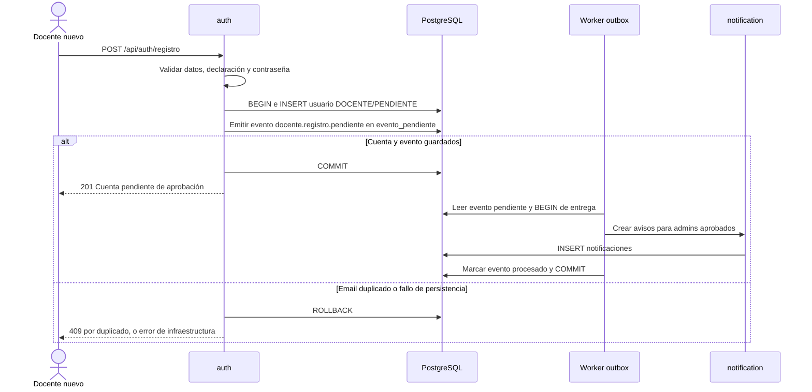

La declaración de curso/materia se conserva como texto, no como asignación.
La ruta pública `GET /api/registro/opciones` ofrece nombres del ciclo activo,
pero registrarse no concede permisos para reservar ni administrar. Los avisos
internos tienen entrega durable; el correo es una copia de cortesía posterior
al commit, con un intento. Un fallo del consumidor conserva el evento para
reintentar sin confirmar avisos parciales.

## 1. Login

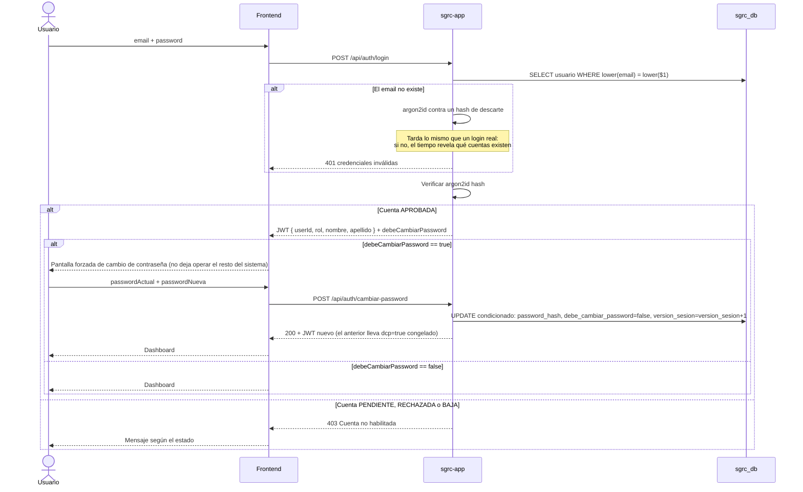

> **Cada request posterior vuelve a mirar la cuenta.** El token prueba la
> identidad, pero el middleware consulta el estado y el rol en la base antes
> de dejar pasar: una cuenta dada de baja pierde el acceso en el momento, no
> cuando expira su token (ver `09-seguridad-rbac.md` §1). El rol que vale es
> el de la base, no el del token.

> El middleware exige HS256, expiración y cuenta vigente, con su rol y versión de sesión actuales. Un token con contraseña temporal sólo puede leer `/api/mi-perfil` y cambiar la contraseña; el resto responde 403. La restricción se aplica en el backend.

## 2. Reservar equipos (uno o varios, en un solo grupo)

```mermaid
sequenceDiagram
    actor U as Docente/Admin
    participant FE as Frontend
    participant RES as reservation (paquete)
    participant INV as inventory (paquete)
    participant DB as sgrc_db

    U->>FE: Selecciona materia, fecha, horario
    Note over FE: Antes de la franja no hay lista que mostrar
    FE->>RES: GET /api/equipos-disponibles?materiaId&fecha&horaInicio&horaFin
    RES->>INV: Listar equipos DISPONIBLE y reservables
    RES->>DB: SELECT reservas y bloqueos que pisan esa franja
    RES-->>FE: Libres y ocupados, con puedeTomarse y puedePedirse
    U->>FE: Tilda equipos libres o tomables por prioridad
    FE-->>U: Explica alcance, reposición y posibles faltantes
    U->>FE: Confirma la reserva
    FE->>RES: POST /api/reservas con equipoIds y equiposATomar
    RES->>RES: Verifica permiso sobre la materia (rol + docente_materia)
    RES->>DB: BEGIN y coordinación del lote
    RES->>RES: Valida jornada, fechas y conflictos actuales
    alt Sin conflictos no autorizados
        opt Hay tomas autorizadas por prioridad
            RES->>RES: Planifica reposiciones en cascada para el horario completo
            RES->>DB: Reasigna sustitutos y cancela faltantes puntuales
        end
        RES->>DB: Crea grupo y reservas, valida exclusión de solapamientos
        RES->>DB: Guarda auditoría y eventos pendientes, COMMIT
        RES-->>FE: 201 con grupo, reservas e impacto de desplazamientos
        FE-->>U: Reserva confirmada y resumen de repuestos y faltantes
    else Conflicto no autorizado o que no cumple las reglas
        RES->>DB: ROLLBACK de la operación completa
        RES-->>FE: 409 "no se pudo reservar: PC 7 ya está reservado el 13/03 de 10:00 a 12:00 (Ada Lovelace)"
        FE-->>U: El mensaje identifica el conflicto; se actualiza la disponibilidad
    end
```

> La creación es transaccional: un conflicto no autorizado o que no cumple las reglas de prioridad impide confirmar el lote. Una toma autorizada puede reponer otras reservas en cascada o cancelar faltantes puntuales; el conjunto se confirma o revierte junto. El cuerpo del 409 es texto plano y nombra el choque: equipo, día, franja y responsable.

> **La misma consulta responde las dos mitades.** Saber qué está libre en una franja exige leer las reservas y bloqueos que la pisan; devolver también quién tiene cada equipo tomado no agrega ninguna ida a la base, solo deja de descartar lo que ya se leyó (RF-04.11).

## 2b. Pedirle equipos a quien los tiene reservados (RF-04.12)

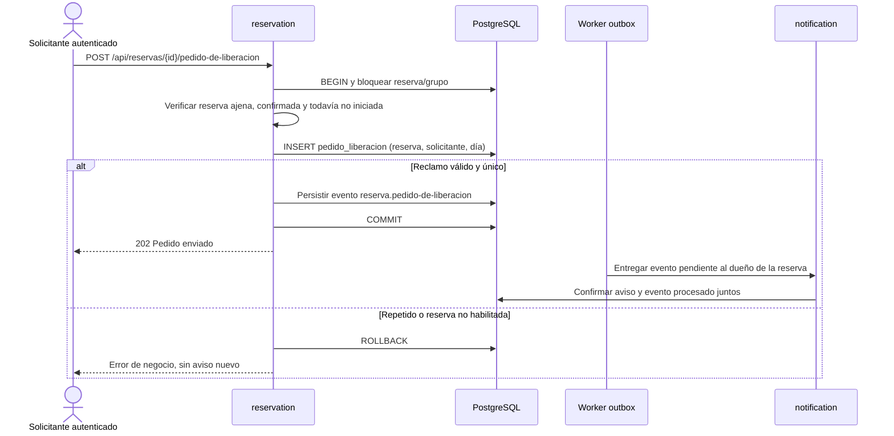

El pedido no modifica la reserva ni concede prioridad. La tabla
`pedido_liberacion` sostiene la unicidad diaria; borrar o leer un aviso no
permite repetir el reclamo. La decisión de liberar sigue siendo del dueño.

## 3. Reserva recurrente (uno o varios equipos)

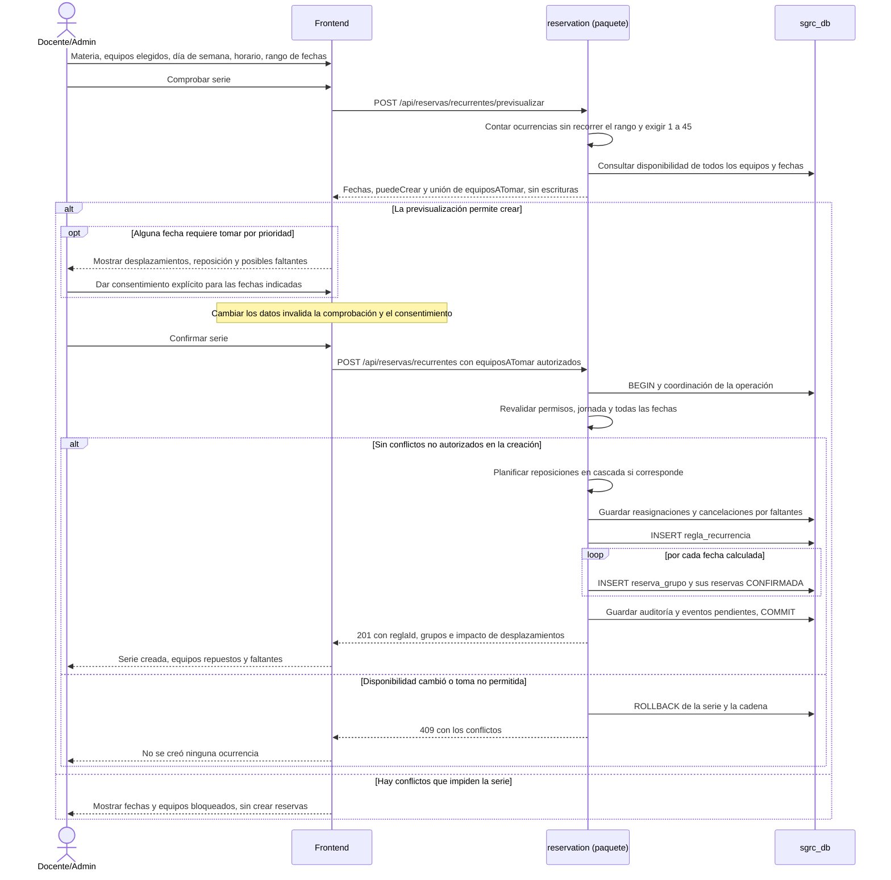

## 4. Cancelar ocurrencia recurrente

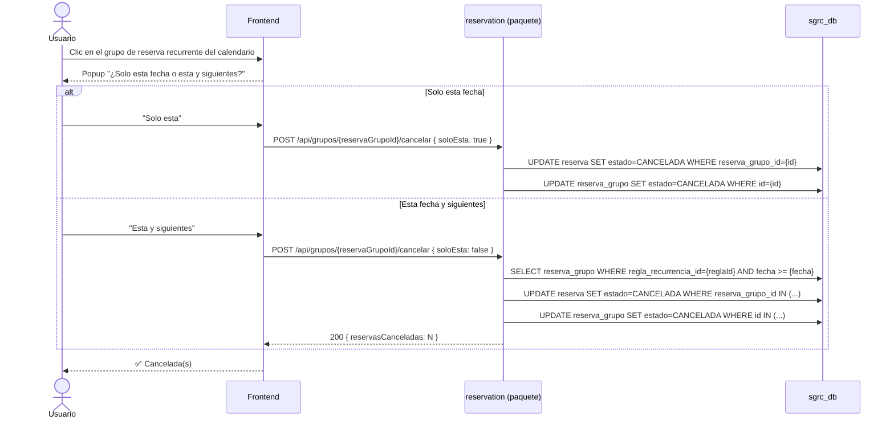

## 5. Bloqueo administrativo de equipos

```mermaid
sequenceDiagram
    actor ADM as Admin
    participant FE as Frontend
    participant RES as reservation (paquete)
    participant EB as eventbus durable
    participant NOTIF as notification (paquete)
    participant DB as sgrc_db

    ADM->>FE: Selecciona los equipos, el rango fecha/hora y escribe el motivo
    FE->>RES: POST /api/bloqueos (JWT)
    RES->>DB: SELECT reserva CONFIRMADA en conflicto (solo esos equipos, ese rango exacto)
    DB-->>RES: [reservas puntuales con reserva_grupo_id, docenteId]
    loop por cada reserva en conflicto
        RES->>DB: UPDATE reserva SET estado=CANCELADA, motivo_cancelacion='los equipos quedaron bloqueados: {motivo}'
        RES->>DB: Recalcular estado de reserva_grupo (PARCIALMENTE_CANCELADA o CANCELADA)
    end
    RES->>DB: INSERT reserva tipo BLOQUEO con motivo_bloqueo (sin materia_id ni reserva_grupo_id) por cada equipo
    RES->>EB: Emitir reserva.cancelada en la outbox de la misma transacción
    EB->>NOTIF: Worker entrega después del commit; aviso y procesado atómicos
    NOTIF->>DB: INSERT notificación por docente, detallando qué equipos puntuales se cancelaron
    RES-->>FE: 201 { bloqueos: [...], reservasCanceladas: N, docentesNotificados: N }
    FE-->>ADM: ✅ Equipos bloqueados. N reservas puntuales canceladas.
```

> Solo se cancelan las `Reserva` (equipo + fecha) que caen dentro del rango exacto del bloqueo. El resto de una recurrencia, o del mismo `ReservaGrupo` en otro horario, sigue vigente.

> **Un solo tipo de evento para los tres orígenes.** RF-05.1, 05.2 y 05.3 son,
> de punta a punta, la misma notificación con distinto motivo: cancelación
> manual de un Admin, bloqueo administrativo, o equipo fuera de servicio. El
> motivo ya viene armado desde `reservation`, así que `notification` no
> necesita saber de dónde vino. El evento se persiste **en la misma
> transacción** y el worker lo entrega después del commit. Un rollback elimina
> también el evento; un fallo de entrega conserva su reintento.

## 6. Cambio de estado de un equipo individual → cascada de cancelación

```mermaid
sequenceDiagram
    actor ADM as Admin
    participant FE as Frontend
    participant INV as inventory (paquete)
    participant EB as eventbus durable
    participant NOTIF as notification (paquete)
    participant DB as sgrc_db

    ADM->>FE: Cambia estado del equipo a EN_MANTENIMIENTO/FUERA_DE_SERVICIO (+ motivo opcional)
    FE->>INV: PATCH /api/equipos/{id}/estado
    INV->>DB: UPDATE equipo SET estado=...
    INV->>DB: SELECT reserva CONFIRMADA de ese equipo puntual con fecha/hora futura
    DB-->>INV: [reservas puntuales con reserva_grupo_id, docenteId]
    loop por cada reserva afectada
        INV->>DB: UPDATE reserva SET estado=CANCELADA, cancelado_por=admin, motivo_cancelacion=(ingresado o por defecto)
        INV->>DB: Recalcular estado de reserva_grupo (PARCIALMENTE_CANCELADA o CANCELADA)
    end
    INV->>EB: Emitir reserva.cancelada en la outbox de la misma transacción
    EB->>NOTIF: Worker entrega después del commit; aviso y procesado atómicos
    NOTIF->>DB: INSERT notificación por docente, detallando que fue ese equipo puntual
    INV-->>FE: 200 { estado, reservasCanceladas: N, docentesNotificados: N }
    FE-->>ADM: ✅ Equipo actualizado. N reservas canceladas y docentes notificados.
```

> Duración **indefinida** (a diferencia del bloqueo administrativo, que tiene rango definido): se cancelan todas las reservas futuras de ese equipo puntual, sin fecha de corte. Cuando el equipo vuelve a `DISPONIBLE`, nada se restaura automáticamente.

## 6b. Dar de baja un equipo del inventario (soft delete)

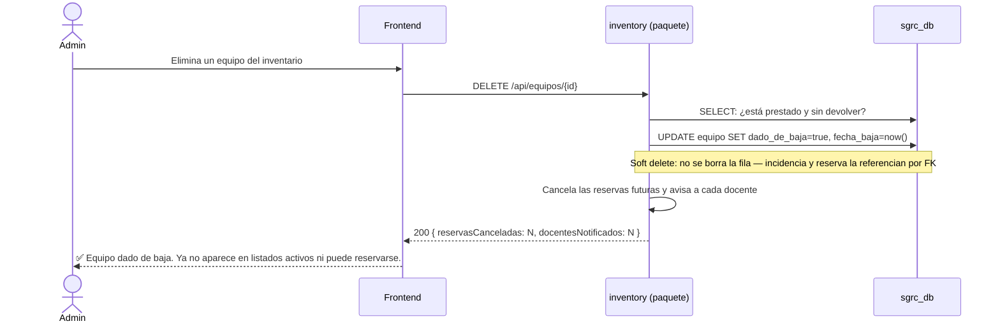

> Un `DELETE` en la API es, puertas adentro, un soft delete: si se borrara la fila físicamente, se perdería la referencia de todo el historial de incidencias y reservas pasadas de ese equipo. Distinto del borrado de reservas al archivar un ciclo lectivo (§7), que sí es físico porque ahí se preserva un snapshot agregado aparte.

> **El `estado` no se toca.** El diagrama decía que la baja lo pasaba a `FUERA_DE_SERVICIO` y eso nunca fue cierto: `dado_de_baja` y `estado` son dos ejes distintos, y la baja sólo mueve el primero. Importa porque es lo que permite que deshacerla devuelva el equipo tal como estaba.

## 6c. Deshacer la baja de un equipo

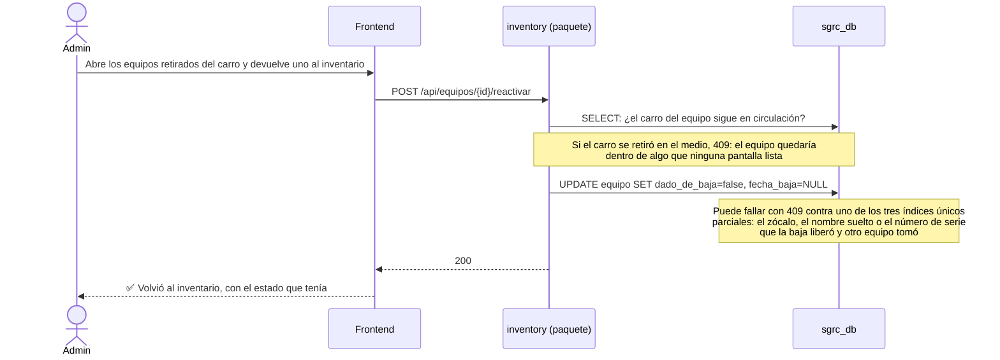

> **No revierte la cascada.** Las reservas que la baja canceló quedan canceladas y los avisos ya salieron. Lo que vuelve es la máquina; por eso esta respuesta no trae ningún contador, a diferencia de la baja.

> El carro sigue el mismo camino con `POST /api/carros/{id}/reactivar`, y ahí lo único que puede fallar es que otro carro se haya quedado con el nombre.

## 7. Archivar y clonar ciclo lectivo

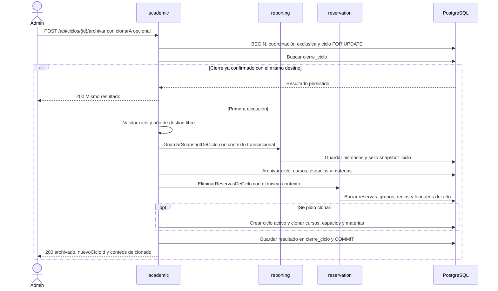

Snapshot, archivo, limpieza y clonado comparten una transacción. Un fallo
revierte todos los pasos. Repetir con otro destino responde 409; un archivo
legado sin constancia también se rechaza. Los históricos quedan sellados
antes de borrar su fuente. Se conservan estructura, asignaciones, incidencias
y préstamos; al borrar reservas, sus referencias en préstamos pueden quedar
nulas. Las asignaciones docentes no se clonan.

## 8. Dar de baja a un docente (permanente y recuperable)

```mermaid
sequenceDiagram
    actor A as Admin
    participant AU as auth
    participant AC as academic
    participant RS as reservation
    participant DB as PostgreSQL
    A->>AU: PATCH estado=BAJA
    AU->>DB: Transacción de preparación: BAJA y materias pendientes
    Note over AU,DB: La cuenta pierde acceso desde este commit
    loop Cada materia todavía pendiente
        AU->>DB: BEGIN con coordinación exclusiva y bloqueo por usuario
        AU->>AC: Verificar otros docentes aprobados
        opt La materia quedó sin docente activo
            AU->>RS: Cancelar reservas futuras con el mismo contexto
            RS->>DB: Actualizar reservas y grupos
            AU->>DB: Persistir evento docente.baja.materia-huerfana
        end
        AU->>DB: Marcar materia completada y COMMIT
    end
    alt Todas las materias completadas
        AU->>DB: Transacción final: remover vínculos y completar baja
        AU-->>A: 200
    else Una materia o la limpieza falló
        AU-->>A: 409 Baja pendiente; repetir estado=BAJA
    end
```

`baja_usuario` y `baja_usuario_materia` conservan el avance después de un
reinicio. Cada materia confirma cancelaciones, evento y avance juntos; el
reintento omite las completadas. Si queda otro docente activo no se cancela
ni avisa. La eliminación definitiva queda bloqueada hasta terminar la baja.
Los eventos confirmados se entregan por el worker durable.

Remover una asignación puntual usa otra operación exclusiva: elimina el
vínculo, comprueba docentes activos restantes y, si corresponde, cancela y
emite `docente.desasignado.materia-huerfana` en una sola transacción. Un fallo
restaura también el vínculo. El resto de materias y la cuenta se conservan.

## 8b. Eliminar definitivamente una cuenta cerrada

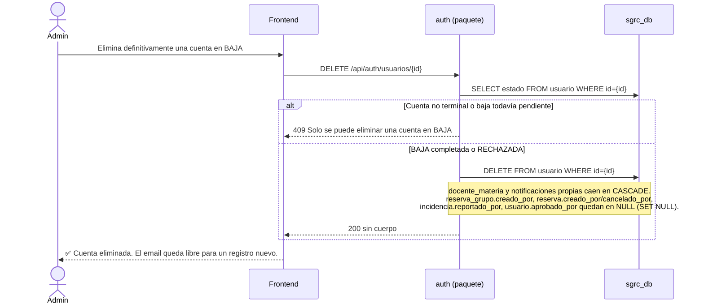

## 9. Los barridos periódicos (sin proceso externo)

Hay **tres barridos**, cada uno en su propia goroutine arrancada por
`cmd/main.go` con un `time.Ticker` y registrada en un `sync.WaitGroup` para que
el apagado ordenado los espere. Ninguno necesita cron ni un proceso aparte.

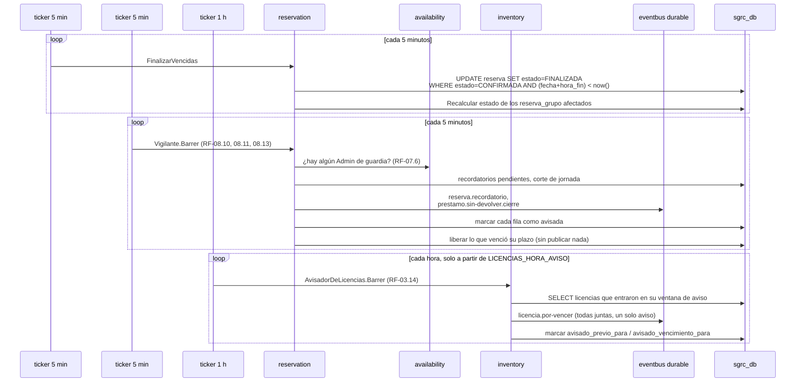

> **`FinalizarVencidas` va por lotes**, cada uno en su propia transacción, con
> corte por falta de progreso y un tope de lotes por ciclo del ticker: el
> primer barrido de una base con años de reservas no puede quedarse tomando un
> lock encima de la tabla que usa el resto del sistema.

> **Ningún aviso depende de que el barrido corra a una hora exacta.** Cada uno
> deja su marca en la fila, así que reiniciar el proceso o estar caído dos
> horas cambia *cuándo* sale el aviso, nunca *cuántas veces* (RF-08).

> **Liberar no publica nada** (RF-08.10) — ni a los 40 sin retiro, ni a los 15
> de una entrega parcial. Es el único punto del barrido donde una reserva cambia
> de estado sin que salga ningún aviso, y desde la 1.18.0 tampoco lo precede
> uno: el de los 15 minutos (RF-08.20) se retiró. Liberar le devuelve la máquina
> al resto de la escuela; no es un reproche que haya que anunciar.

> **Antes de deducir nada, el barrido pregunta si había alguien** (RF-07.6).
> Las dos pasadas que concluyen algo a partir de un registro FALTANTE —liberar
> y el corte de fin de jornada— consultan primero a `availability` si algún
> Admin tenía horario que cubriera ese momento
> y no declaró ausencia. Sin nadie atendiendo el mostrador, el barrido lee su
> propio silencio y no la realidad del laboratorio, así que no escribe ni avisa
> nada. El recordatorio es la excepción: no deduce nada de lo que falta.
>
> El corte de jornada usa la variante **por día** y no por instante, porque sale
> una hora después de que la escuela cerró: para entonces el Admin ya se fue, y
> preguntar por ese momento daría "no hay nadie" siempre.

## 10. Ver disponibilidad de Admins

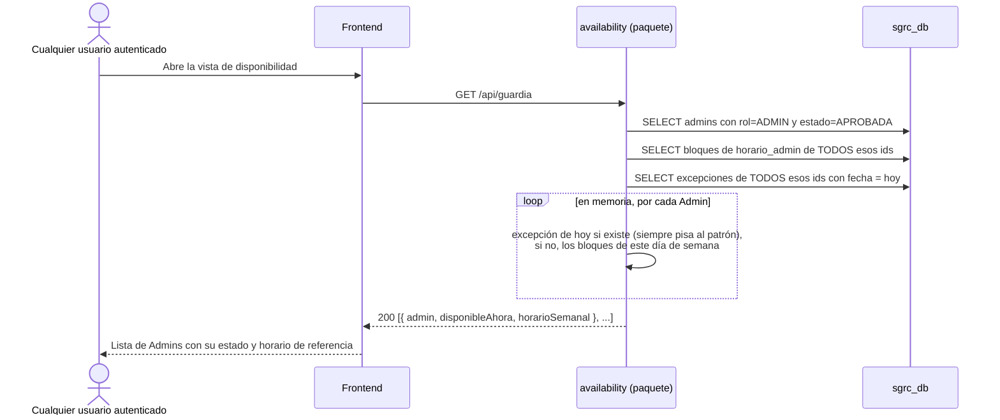

> **Dos consultas en total, no dos por Admin.** Resolverlo dentro del bucle
> serían 2N viajes a la base para armar una pantalla que mira cualquier
> docente; el cálculo en sí no toca la base, así que se traen los dos conjuntos
> de una vez y se cruzan en memoria.

> Este cálculo **no habilita ni bloquea ninguna acción que haga una persona**
> (RF-07.6): reservar, entregar y aprobar funcionan igual esté quien esté. Pero
> desde la 1.18.0 **sí decide si el barrido automático puede sacar
> conclusiones** — es la misma consulta que responde `MostradorEn`. Un horario
> mal cargado ya no es solo una pantalla que miente.

## Contrato transaccional común

Las secuencias resumen los casos de uso; los locks y triggers transversales
se detallan en `06-arquitectura.md`. En producción, cambios sensibles y
auditoría se confirman juntos. Los eventos internos se persisten con su
operación y el worker confirma aviso/procesado juntos. El correo mantiene un
intento posterior al commit. Esto también aplica a los barridos: sus marcas
y eventos comparten transacción, sin publicar avisos de marcas revertidas.
