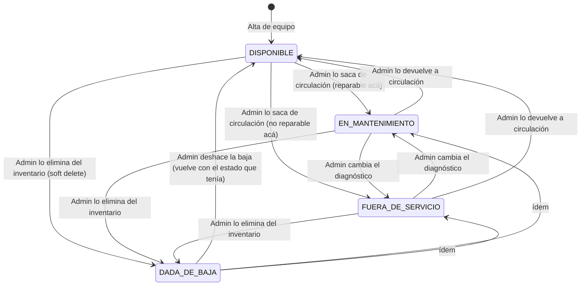
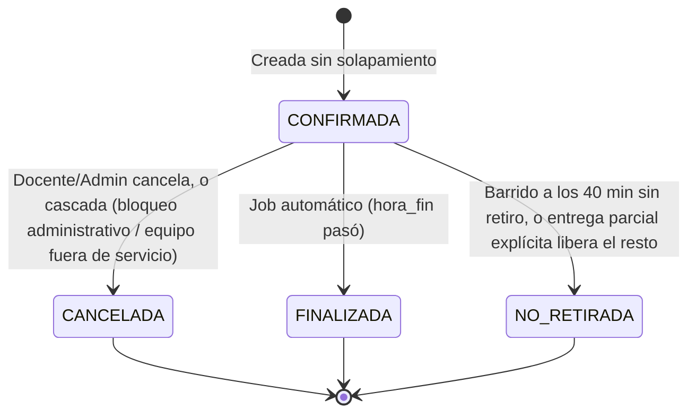
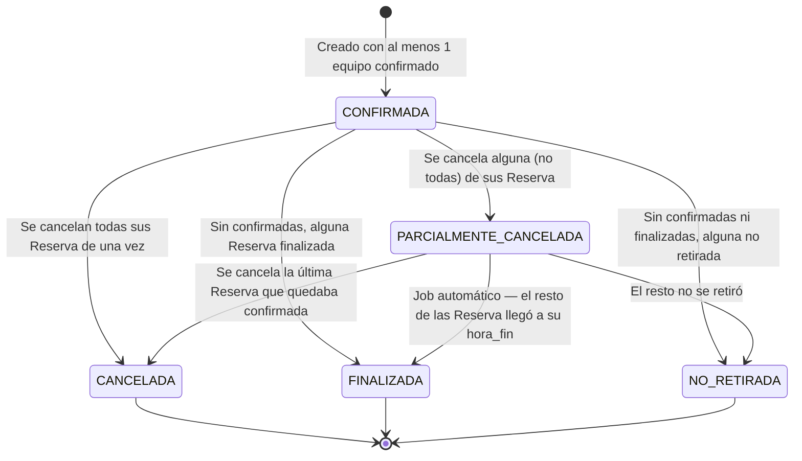
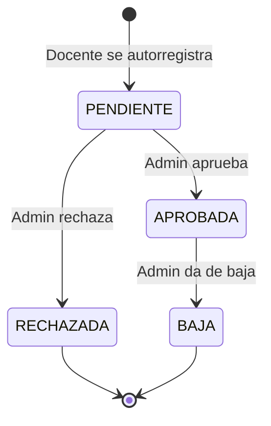
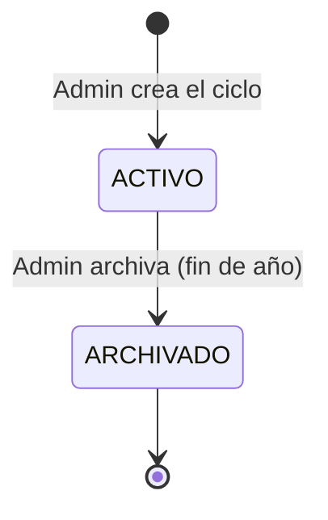

# Diagramas de Estado — SGRC

## Estado de un Equipo

> **El estado lo decide una persona, no el sistema.** Registrar una incidencia
> no cambia el estado del equipo, y la categoría de la falla tampoco: la
> diferencia entre `EN_MANTENIMIENTO` y `FUERA_DE_SERVICIO` no es qué se rompió
> sino **si la institución puede repararlo** —si tiene el repuesto, el
> conocimiento o la autorización—, y eso no se deduce de un diagnóstico
> (RF-03.5).

> `DADA_DE_BAJA` es independiente del campo `estado` (`DISPONIBLE`/`EN_MANTENIMIENTO`/`FUERA_DE_SERVICIO`) — es el flag `equipo.dado_de_baja`, no un cuarto valor de ese enum. Se muestra acá junto al resto porque es el final del ciclo de vida habitual del equipo. **No se permite sobre un equipo prestado** (RF-03.20): primero hay que registrar que volvió.

> **La baja NO fija `estado = FUERA_DE_SERVICIO`.** Este archivo lo afirmaba y nunca fue cierto: `DarDeBaja` mueve `dado_de_baja` y `fecha_baja`, y nada más. Es exactamente lo que permite que deshacerla devuelva el equipo con el estado que tenía — si estaba roto vuelve roto, y ponerlo `DISPONIBLE` sería inventar que alguien lo arregló. El mismo error estaba en `04-diagramas-secuencia.md` §6b; los dos corregidos el 2026-09-12.

> **La baja tampoco es terminal.** Se deshace: `POST /api/equipos/{id}/reactivar` devuelve el equipo al inventario con el estado que tenía. Lo que no vuelve es la cascada — las reservas que la baja canceló quedan canceladas y los avisos ya salieron—, y puede fallar si alguien se quedó con lo que la baja liberó: el zócalo, el nombre suelto o el número de serie. Lo único terminal del sistema es una **cuenta** en `BAJA` (ver `02-casos-de-uso.md`), y la asimetría es deliberada: un equipo retirado por error sigue siendo el mismo equipo.

> Los tránsitos hacia `EN_MANTENIMIENTO`/`FUERA_DE_SERVICIO` son de duración **indefinida** y disparan cancelación en cascada de las reservas futuras de ese equipo puntual (RF-03.8). El regreso a `DISPONIBLE` no restaura nada automáticamente.

> **`FUERA_DE_SERVICIO` no es terminal.** Un equipo reparado puede volver a circulación. La baja lógica es otra columna y también puede deshacerse; ninguna de las dos operaciones restaura reservas canceladas.

## Estado de una Reserva (un equipo puntual)

## Estado de un ReservaGrupo (la reserva tal como la ve el docente)

> `PARCIALMENTE_CANCELADA` requiere alguna reserva cancelada y alguna confirmada.
> El grupo pasa a `CANCELADA` cuando todas están canceladas. Sin confirmadas,
> `FINALIZADA` tiene prioridad si alguna finalizó; en caso contrario,
> `NO_RETIRADA` tiene prioridad si alguna no se retiró. El recálculo se confirma
> junto con los cambios de las reservas bajo los mismos bloqueos.

## Estado de cuenta de Usuario

> `RECHAZADA` y `BAJA` son estados distintos: `RECHAZADA` es para una solicitud que nunca llegó a aprobarse; `BAJA` es para una cuenta que **estuvo** activa y luego se dio de baja (dispara la revisión de reservas huérfanas de RF-02.8).

## Estado de un Ciclo Lectivo

> **Solo puede haber un ciclo `ACTIVO` a la vez**, y lo garantiza un índice
> único parcial en la base (RF-02.1). El administrador elige cerrar sin abrir
> otro ciclo o crear uno nuevo copiando la estructura. Si elige copiar, archivo
> y clonado ocurren en la misma transacción: el ciclo que se cierra deja de ser
> activo y el nuevo nace con cursos, espacios y materias copiados, sin asignaciones
> docentes. Si cierra sin copiar, no queda ningún ciclo activo; puede crear uno
> después. El nuevo tiene otro ID: el archivado no vuelve a `ACTIVO`.
> Repetir el cierre conserva el resultado original; un fallo anterior al commit
> revierte todos los pasos.

## Préstamo de un Equipo

No lleva diagrama porque tiene dos estados y uno solo de salida: está
**abierto** mientras `devuelto_en` sea `NULL`, y se cierra al recibirlo. Lo
que importa de un préstamo no es su estado sino su relación con la reserva —
son cosas distintas, ver RF-08 y `07-modelo-datos.md`.

## Reglas asociadas

> **`NO_RETIRADA` no es `CANCELADA`, y la diferencia importa.** Una
> cancelación la decidió alguien y pide saber quién y por qué; una reserva no
> retirada se explica sola. Y sobre todo, la franja **deja de bloquear**: el
> `EXCLUDE` de anti-solapamiento solo mira las `CONFIRMADA`, así que liberar
> una reserva es un cambio de estado y nada más.
>
> **`NO_RETIRADA` es terminal y no vuelve a `CONFIRMADA`**, aunque el docente
> aparezca pasado el plazo de gracia: liberar no es prohibir. Si las máquinas
> siguen ahí se le entregan igual, y eso queda registrado como un *préstamo*,
> que es otra cosa que la reserva.
>
> **A nivel `ReservaGrupo` solo se marca si NINGUNO de sus equipos se retiró.** Si
> el docente vino y se llevó tres de cinco, el grupo sigue `CONFIRMADA`: vino
> a dar la clase, y lo que pasó con los otros dos se ve fila por fila.
>
> **La misma transición sale de dos plazos, y ninguno avisa** (RF-08.10). Si no se
> retiró nada, se espera desde el inicio de la clase (40 min por defecto); si el
> docente se llevó una parte, lo que dejó cae a los 15 minutos de esa entrega. En
> los dos casos la liberación es **silenciosa**, y desde la 1.18.0 tampoco la
> precede ningún aviso —el de los 15 minutos, RF-08.20, se retiró—. Es la única
> transición del sistema que no genera ninguna notificación.
>
> Lo que la hace confiable no es un aviso previo sino **la condición del
> mostrador** (RF-07.6): esta transición solo ocurre si había un Admin de
> guardia registrando entregas. Sin nadie operando el sistema, "ninguna máquina
> figura entregada" no significa que nadie vino, así que la reserva **no pasa a
> `NO_RETIRADA`**: sigue `CONFIRMADA` y termina en `FINALIZADA` por RF-04.9,
> como cualquier clase que se dio.

- Equipo en `EN_MANTENIMIENTO`, `FUERA_DE_SERVICIO` o `dado_de_baja=true` rechaza nuevas reservas, **y también rechaza entregas**: está físicamente en el laboratorio y no se le da a nadie (RF-08.17). Llevarle una máquina rota al técnico sigue registrándose, pero como *salida a reparación* (RF-08.21), que exige decir a dónde va y vive en un panel aparte del mostrador. Lo dado de baja no sale por ningún camino.
- `Reserva` `CANCELADA` o `FINALIZADA` es inmutable; lo mismo aplica a `ReservaGrupo`. Ambas se eliminan físicamente al archivar el ciclo lectivo de su materia (no antes).
- Cursos, espacios y materias archivados no aparecen en vistas activas y se preservan al cerrar el ciclo. El CRUD sólo permite eliminar estructura sin archivar y sin reservas.
- Un usuario con `estado=PENDIENTE`, `RECHAZADA` o `BAJA` no puede operar en el sistema aunque intente autenticarse. `BAJA` es terminal — no hay reactivación.
- Dar de baja a un docente (`APROBADA → BAJA`) solo cancela reservas si la materia queda sin ningún otro docente activo (ver RF-02.8).
- Dar de baja un equipo (`dado_de_baja=true`) es un soft delete: la fila se conserva para no perder el historial de incidencias y reservas ya asociadas.
