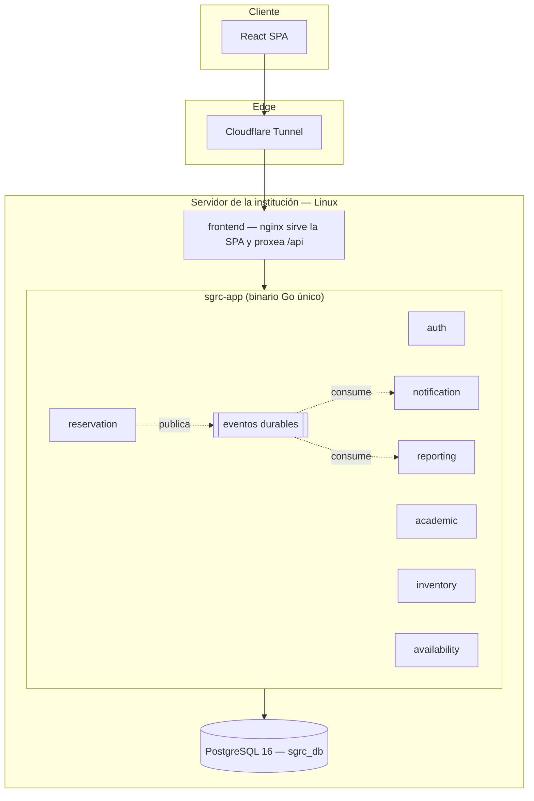
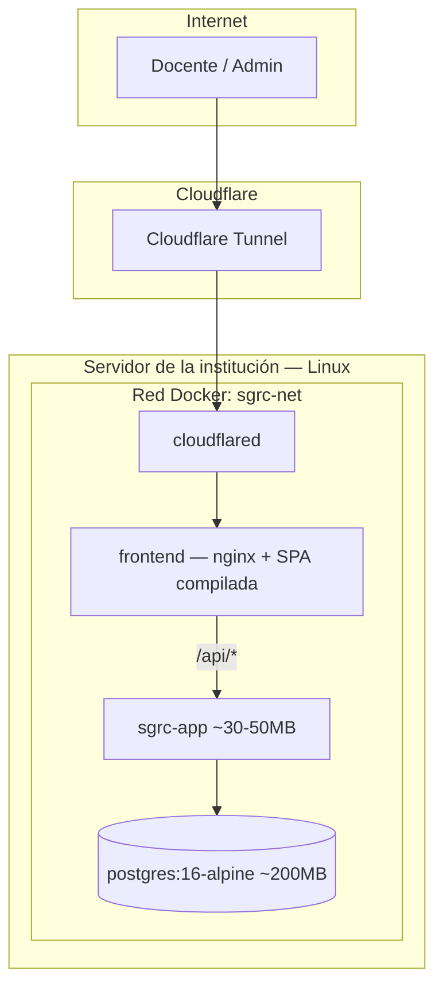

# Arquitectura del Sistema — SGRC

## 1. Criterio de diseño

**Monolito modular con límites de dominio explícitos.** Un solo binario Go y un solo Postgres, organizados en paquetes internos que se comunican solo a través de interfaces — ningún paquete importa `domain/` de otro directamente. Para el volumen de uso real (una sola institución, decenas de usuarios, un servidor con recursos acotados) no se justifica la complejidad operativa de microservicios (mensajería entre procesos, bases de datos separadas, orquestación). Los límites de paquete se mantienen igual de estrictos que si fueran servicios separados, de forma que el sistema quede preparado para dividirse en microservicios el día que el volumen de uso lo justifique (por ejemplo, si el proyecto crece a más de una institución), sin tener que reescribir la lógica de dominio.

## 2. Estructura del binario

| Paquete | Responsabilidad |
|---|---|
| `internal/auth` | Usuarios, JWT, aprobación de cuentas docentes |
| `internal/academic` | Ciclos lectivos, cursos, materias, DocenteMateria, clonado y carga masiva |
| `internal/inventory` | Carros, equipos, incidencias, licencias |
| `internal/reservation` | Reservas, solapamiento, recurrencias, bloqueo, job de vencimiento |
| `internal/notification` | Notificaciones internas y las copias por email de algunas de ellas (RF-05.8) |
| `internal/reporting` | Estadísticas y reportes: queries agregadas directas para el ciclo activo + snapshot histórico permanente calculado al archivar |
| `internal/availability` | Horario de guardia de los Admin y jornada de la institución — cálculo de "disponible ahora" y de si el mostrador está atendido (RF-07.6) |
| `internal/shared/middleware` | JWT + verificación de cuenta, RBAC, rate limiting, headers de seguridad |
| `internal/shared/eventbus` | Outbox PostgreSQL y bus de pruebas (ver §4) |
| `internal/shared/security` | Hash y verificación de contraseñas (`argon2id`), en un solo lugar |
| `internal/shared/email` | Envío por SMTP (`net/smtp`, texto plano). Está en `shared/` porque lo usan dos: `notification` para los avisos y `auth` —indirectamente, vía evento— para el código de recuperación. Arma el mensaje a mano, y esa lista de cabeceras es deliberada: `From` igual a la cuenta que autentica (lo exige Gmail y es lo que alinea DMARC), `Auto-Submitted` para que ningún autorespondedor conteste, `Message-ID` propio —Gmail lo agrega si falta, pero cualquier otro SMTP deja salir el mensaje sin él y para varios filtros eso solo ya es señal de correo automático mal armado— y texto plano, sin HTML ni imágenes, que no tiene ratio que penalizar |
| `internal/shared/secretos` | AES-256-GCM para contraseñas de cuentas de equipo y payloads de eventos pendientes, con claves separadas. `CUENTAS_SECRET` es opcional; sin ella no se guardan secretos de equipos. La outbox usa `OUTBOX_SECRET` o una derivación separada de `JWT_SECRET`, cuya clave debe conservarse mientras haya eventos pendientes |
| `internal/shared/audit` | Escritura del `audit_log` (ver `09-seguridad-rbac.md` §5) |
| `internal/shared/paginacion` | Ventana de resultados y `meta` de los listados paginados |
| `internal/shared/texto` | La única regla que decide si dos textos nombran la misma cosa. Espeja `clave_texto()` de la base, con un test de paridad contra Postgres (RF-00.1) |
| `internal/shared/respuesta` | Lo que todas las capas HTTP contestan igual. Hoy: el `201` con su `Location`. Está en `shared/` por lo mismo que `paginacion` — escrita nueve veces, la regla se despega de a poco hasta dejar de ser una regla |
| `internal/shared/adminseed` | Decisión de "sembrar el primer Admin si hace falta", sin dependencias externas |
| `internal/shared/archtest`, `authtest`, `testdb` | Solo para tests: el que verifica los límites de paquete, el armado de autenticación y el Postgres efímero |

```
sgrc/
├── cmd/
│   └── main.go
├── internal/
│   ├── auth/{domain,application,infrastructure,interfaces/http}
│   ├── academic/{...}
│   ├── inventory/{...}
│   ├── reservation/{...}
│   ├── notification/{...}
│   ├── reporting/{...}
│   ├── availability/{...}
│   └── shared/{middleware, eventbus, security, secretos, email, audit, paginacion, adminseed, …}
├── migrations/
├── frontend/                 ← SPA React servida por nginx (ver README)
├── scripts/
├── Dockerfile
├── docker-compose.yml
├── docker-compose.dev.yml
└── Makefile
```

## 3. Comunicación entre paquetes

Cada paquete expone una interfaz pequeña en su capa `application/`; los demás paquetes dependen de esa interfaz, nunca del paquete `domain/` ajeno:

```go
// internal/reservation/application/ports.go — el puerto lo declara quien lo
// necesita, no quien lo implementa.
type ValidadorEquipo interface {
    EquipoDisponibleParaReservar(ctx context.Context, equipoID string) (bool, error)
}

// internal/reservation/application/service.go
type Service struct {
    validadorEquipo ValidadorEquipo // inyectado; nunca se importa inventory/domain
}
```

Hay dos formas de implementar esos puertos, y la diferencia importa:

- **Lecturas simples** (¿este equipo está disponible?, ¿este usuario está
  aprobado?): las resuelve el propio `infrastructure/` del paquete que
  pregunta, con un SQL directo sobre la tabla ajena. No hay reglas de negocio
  que duplicar.
- **Acciones con reglas propias** (cancelar las reservas de una materia,
  borrar las de un ciclo): las implementa `cmd/wiring_adapters.go`,
  envolviendo el `Service` del paquete dueño. Cancelar una reserva tiene una
  máquina de estados y un recálculo del grupo padre; reimplementar eso con
  SQL crudo en otro paquete es cómo dos caminos al mismo estado terminan
  comportándose distinto.

Un test de arquitectura (`internal/shared/archtest`) verifica que ningún
paquete importe el `domain/` de otro, así que el límite no depende de que
alguien se acuerde.

Este es el mismo contrato que tendría una llamada REST entre servicios separados — solo que resuelto en compile-time y sin latencia de red. Si algún paquete necesitara convertirse en un servicio aparte más adelante, se reemplaza la implementación en memoria por un cliente HTTP que cumpla la misma interfaz, sin tocar el resto del código.

## 4. Eventos durables y consumidores

```go
// internal/shared/eventbus/eventbus.go
type Evento struct {
    Tipo    string
    Payload any
}

type EventBus interface {
    Publish(evento Evento)
    Subscribe(tipo string, handler func(Evento))
}
```

`reservation` emite eventos como `reserva.cancelada` y `reserva.reubicada`; `notification` registra los consumidores de avisos internos y correo en el arranque (`cmd/main.go`). `DurableBus` conserva los eventos pendientes en PostgreSQL. Los publicadores usan `Emitir` con contexto transaccional; `Publish` queda para el adaptador en memoria y los observadores de cortesía.

**Los filtros van en la query, no en el path.** Fiber resuelve las rutas por orden de registro, así que un segmento literal (`/equipos/sueltos`) tendría que registrarse **antes** que el parámetro que lo puede tragar (`/equipos/:id`). Invertido, la ruta literal deja de existir y el handler del `:id` responde 404 buscando un equipo con ese ID: compila, arranca y falla recién en tiempo de ejecución. Un comentario pidiendo que nadie reordene las líneas no es una garantía.

La convención evita el problema en vez de documentarlo: **una condición sobre una colección es un query param** (`/equipos?enCarro=false`), y **un concepto distinto es una colección hermana** (`/categorias-de-falla`, que no son incidencias sino el vocabulario con el que se las clasifica). Lo que sí puede ir en el path es una relación real de pertenencia: `/carros/{id}/equipos` son los equipos DE ese carro.

**Tres casos no se pudieron evitar, y ahí el orden lo sostiene un test.** `/preferencias/huerfanas`, `/notifications/leidas` y `/notifications/preferencias-email` son conceptos distintos que comparten posición con un `:id`, y los tres se volvieron frágiles el día que se agregó el `GET` o el `DELETE` de ese recurso individual. Están registrados **antes** que la ruta con parámetro, y cada uno tiene un test que pide la ruta literal y exige un 200: si alguien reordena las líneas, el test falla en vez de que la ruta desaparezca en silencio. Es la única forma de convertir "no reordenes esto" en una garantía.

**Y un cuarto caso que el orden NO podía sostener.** Los tres reportes de incidencias vivían en `/api/incidencias/equipos`, `/carros` y `/categorias`, y `GET /api/incidencias/{id}` se los comía: "equipos" entraba como id, no era un UUID y las tres respondían `400 el ID indicado no tiene un formato válido`. La pestaña de Reportes mostraba ese error y esos reportes no se ejecutaban nunca. La colisión la creó aplanar los prefijos —antes eran `/api/reporting/incidencias/equipos` y no se cruzaban con nada— y pasó inadvertida porque ningún test pedía esas rutas.

La diferencia con los otros tres es lo que decidió el arreglo: **las dos rutas están en módulos distintos**, así que el orden no se decide dentro de un `routes.go` sino en la secuencia de `RegisterRoutes` de `cmd/main.go`, donde no lo ve quien lee ninguno de los dos archivos. Ordenar habría funcionado y habría dejado una trampa invisible. Ahora cuelgan de `/api/incidencias/resumen/por-equipo` y hermanas: un segmento más, y no queda nada que ordenar.

La moraleja para la próxima vez que se muevan prefijos: **aplanar rutas puede crear colisiones que antes no existían**, y el compilador no las ve. Dos rutas que nunca se cruzaron pueden pasar a competir porque se les sacó un segmento a las dos.

**El prefijo de cada ruta es el recurso, no el módulo.** Todas cuelgan de `/api` y el segmento siguiente nombra la cosa: `/api/equipos`, `/api/ciclos`, `/api/reservas`. Antes de unificar las rutas, el prefijo era el paquete de Go que servía la ruta —`/api/inventory/equipos`, `/api/academic/ciclos`— y eso obligaba a saber cómo está partido el servidor por dentro: el calendario de una máquina lo sirve `reservation` aunque la máquina sea de `inventory`, así que estaba en `/api/reservation/equipos/{id}/calendario`. Cuatro recursos vivían bajo dos módulos a la vez.

Las cuatro excepciones son recursos que **ya** se llamaban por su nombre y se quedaron: `/api/auditoria`, `/api/notifications`, `/api/sugerencias` y `/api/jornada`. Y `/api/auth`, donde el segmento sí es el recurso: autenticarse. Lo propio de cada persona cuelga de `/api/mi-…` o `/api/mis-…` en la raíz, porque no es parte de autenticarse sino el usuario mirando lo suyo.

**Los eventos de producción se persisten con su operación.** `eventbus.Emitir(ctx, bus, evento)` escribe en `evento_pendiente` dentro de la transacción compartida. Si falla esa escritura, se revierte el cambio de negocio. Un worker de `main.go` procesa la cola cada segundo, hasta 50 eventos por pasada; el bus en memoria se conserva como adaptador de pruebas.

**El aviso interno y la entrega del evento se confirman juntos.** Los consumidores de `notification` usan la misma conexión que el worker. Un fallo o panic revierte todos los destinatarios de ese evento y deja la fila pendiente, con reintentos de hasta 60 segundos de espera. Un advisory lock de entrega serializa instancias y conserva el orden de la cola: un fallo bloquea los eventos posteriores hasta poder reintentarlo. La marca de procesado evita duplicados entre workers y reinicios. Los escritores de un mismo pedido/hilo se serializan antes de emitir sus eventos; además, un aviso entregado después de resolver su tarea se guarda como leído.

**El correo es una copia de cortesía con un intento.** Se inicia después de confirmar los avisos internos y fuera de la transacción. Un fallo SMTP o una caída en esa ventana puede perder el correo; no revierte el aviso ni lo reenvía. `sync.WaitGroup` espera los envíos iniciados durante el apagado ordenado. La recuperación por email conserva esta política: solicitar un código persiste el código y el evento juntos; si no llega su correo, se puede solicitar otro.

**El payload pendiente está cifrado.** Incluye datos privados y, en recuperación, el código para el correo. AES-GCM usa `OUTBOX_SECRET`, o una derivación separada de `JWT_SECRET` cuando aquella está vacía. Al confirmar la entrega se vacía el payload; se conserva la metadata del evento. Ver las condiciones de rotación en `11-operacion.md`.

**`prestamo` vive en `reservation` y no en `inventory`, aunque hable de un equipo.** El criterio no es de qué entidad cuelga sino de qué reglas depende: contra qué reserva salió la máquina, si volvió antes de que empiece la siguiente, quién es el próximo que la tiene reservada. Ponerlo en `inventory` obligaría a ese paquete a leer reservas, que es exactamente el límite que §3 no deja cruzar. Lo único que necesita de `inventory` —que el equipo exista y no esté dado de baja— entra por el puerto `ValidadorEquipo` que ya existía.

**Los barridos también producen eventos durables.** El barrido de licencias, los recordatorios y el corte de entregas toman la coordinación institucional exclusiva. La marca de aviso y su evento se confirman juntos: un fallo revierte ambos y una segunda instancia vuelve a leer la marca después de esperar. Liberar una reserva no genera los avisos retirados `reserva.sin-retirar`, `prestamo.demorado` o `reserva.equipo-no-disponible`.

**El payload lleva el dato, no solo el ID.** Los eventos de correo (`cuenta.aprobada`, `password.recuperacion.solicitada`) viajan con nombre y email adentro y no con un `usuarioId` a resolver: el suscriptor vive en `notification`, que no puede importar el `domain` de `auth` (§3), así que resolverlo del otro lado significaría o violar el límite o agregar otro puerto de lectura para algo que quien publica ya tenía en la mano.

Se modela como pub/sub (en vez de que `reservation` llame directo a `notification.Notificar()`) porque preserva un patrón de event-driven design real y deja la puerta abierta a que la implementación pase a un message broker (NATS, Kafka) sin tocar quién publica o se suscribe, si en el futuro hace falta desacoplar procesos.

## 5. Transacciones: `EnTransaccion` en el puerto

Una operación que escribe varias filas se envuelve en una transacción, y la
forma es siempre la misma: el puerto `Repo` del paquete expone

```go
EnTransaccion(ctx context.Context, fn func(Repo) error) error
```

y el servicio hace sus escrituras contra el `Repo` que recibe adentro. La
implementación abre la transacción, corre `fn` con un repo atado a ella, y
commitea sólo si `fn` no devolvió error.

**Por qué en el puerto y no en el servicio.** El servicio no sabe que existe una
base de datos, y no debería: lo que declara es «esto va junto». Que eso se
resuelva con `BEGIN`/`COMMIT`, con un lote, o con nada —como en los tests, donde
el fake corre `fn` derecho— es problema de quien implementa el puerto.

**Reentrante a propósito.** Si el repo ya viene atado a una transacción,
`EnTransaccion` reusa la misma en vez de anidar, para que el alcance del commit
siga siendo el de afuera.

**Coordinación entre inventario, reservas, jornada y docentes.** Los tres primeros puertos exponen
`Coordinar(ctx, exclusivo, fn)`. El adaptador abre o reutiliza una transacción
READ COMMITTED y transporta su conexión en el contexto mediante
`internal/shared/pgtransaccion`. Los adaptadores de composición propagan ese
contexto; validadores y repositorios lo usan en lugar de pedir otra conexión.

La coordinación usa un advisory lock transaccional por base. Reservas simples
y recurrentes sin desplazamientos, bloqueos, cambios de equipo y entregas sin
reserva toman el modo compartido; las entregas contra reserva, los cambios de
inventario (incluidas las preferencias), las devoluciones, el
reemplazo de jornada y cada liberación automática toman el exclusivo. Las
entregas contra reserva mantienen estable el calendario al comprobar las clases
intermedias antes de una salida anticipada. Las devoluciones se serializan
también entre equipos distintos: el último retorno
debe observar los anteriores al contar pendientes y cerrar el aviso del cierre.
Este bloqueo reduce el paralelismo de esas operaciones a cambio de mantener
coherente el contador institucional. Se adquiere antes de leer o bloquear
filas; después se mantiene el orden de H-12: grupos por ID y reservas por ID.
No se permite convertir una operación compartida a exclusiva.

Academic usa `CoordinarAsignaciones(ctx, fn)` en modo exclusivo para asignar,
cambiar rol, remover y resolver pedidos de materia. Auth toma el mismo modo
en cada fase de `EnBaja`, antes del bloqueo por usuario y de las filas de cuentas.
La remoción elimina el vínculo, comprueba los docentes `APROBADA` restantes y
cancela reservas en una sola transacción. Un fallo revierte todos esos cambios;
los avisos se publican después del commit. Las bajas conservan los commits y el
progreso por materia de H-07: no se convierten en una única transacción global.
Los validadores de reservas leen cuenta y asignación bajo el modo compartido;
un vínculo pendiente de limpieza no autoriza a una cuenta `BAJA` a reservar
como docente. La aprobación de un pedido adquiere la coordinación antes de
bloquear el pedido y reutiliza la misma transacción al asignar.

Así, disponibilidad, comprobación de custodia y escritura se resuelven sobre
un estado estable. El equipo o la jornada y sus cancelaciones se confirman
juntos; el rollback descarta también los callbacks de avisos. Las operaciones
de reserva/entrega conservan concurrencia entre sí. La elección de un lock
institucional serializa cambios administrativos aunque afecten equipos
distintos; cualquier nuevo escritor que afecte estas invariantes debe usar
el mismo protocolo. Los eventos y marcas de aviso se incluyen en la transacción mediante la outbox durable.

**Lo que obliga a que el duplicado no sea un error.** En Postgres una sentencia
que falla **aborta la transacción entera**: de ahí en adelante todo responde
«current transaction is aborted». Eso choca de frente con las altas masivas, que
tienen que poder saltear lo que ya existe y seguir. Por eso las inserciones de
un lote usan `ON CONFLICT DO NOTHING` y devuelven un `bool` —«la creé» o «ya
estaba»— en lugar de dejar reventar el INSERT y atrapar el 23505.

Es la diferencia entre dos cosas que parecen la misma: *un duplicado* no es un
error del lote y no lo voltea; *un fallo real* sí, y deshace todo.

**Los barridos también se envuelven.** El barrido de licencias y el de recordatorios/cierre confirman marcas y eventos juntos. El correo queda fuera: empieza después de confirmar los avisos internos y conserva su política de cortesía. Así un fallo al guardar una marca no produce un aviso duplicado en la siguiente pasada.

## 6. Topes: pool, consultas y transacciones

`pgxpool` con los defaults deja dos huecos que sólo se notan el día que algo va
mal, y los dos se cierran en `abrirPool` (`cmd/main.go`):

| tope | valor | qué evita |
|---|---|---|
| `MaxConns` | 20 | Un pool que se dimensiona solo según los núcleos de la máquina es difícil de razonar cuando algo va lento. 20 deja lugar de sobra bajo el límite de 100 de Postgres para psql, las migraciones y una segunda instancia durante un despliegue. |
| `statement_timeout` | 30 s | **El que faltaba.** Sin él, una consulta que se va de las manos se queda con una conexión indefinidamente, y con veinte alcanzan veinte de ésas para que el sistema deje de responder aunque Postgres esté perfecto. |
| `idle_in_transaction_session_timeout` | 60 s | Una transacción abierta y quieta es peor que una consulta lenta: retiene su conexión **y** bloquea la limpieza de filas viejas en toda la base. |
| `MaxConnLifetime` / `MaxConnIdleTime` | 30 / 5 min | Que una caída del otro lado —un reinicio, un cortafuegos que olvida la sesión— se note y se reponga, en vez de quedar como una conexión muerta que falla recién cuando alguien la usa. |

Los dos timeouts van en la **configuración de la conexión** y no en un `SET`
suelto: así los hereda toda conexión que el pool abra, incluidas las que reponga
más tarde. Un `SET` después de conectar se aplicaría a una sola. Hay un test de
integración que lo comprueba y otro que verifica que el tope **corte** de
verdad.

Cerrar el año no corre por este camino —va en su propia transacción— así que el
tope de 30 segundos no lo limita.

**Las operaciones de lote leen de a una consulta, no de a un elemento.** Un
pedido puede traer hasta `MaxEquiposPorOperacion` = 200 máquinas —entregar contra
reserva, recibir un lote, cancelar por ids, bloquear equipos—. Antes de agrupar
las lecturas, cada uno de esos bucles pedía su fila por separado. Ahora hay tres lecturas por
lote (`BuscarReservasPorIDs`, `BuscarPrestamosPorIDs`,
`ListarReservasFuturasDeEquipos`) y el bucle sólo consulta el mapa que ya tiene.

Las tres devuelven un **mapa por id** y no una lista, y eso no es estilo: es lo
que preserva las dos cosas que la conversión rompe en silencio. El **orden** lo
pone quien llama recorriendo su propia lista de ids, porque el resultado de una
entrega se arma en el orden en que la pantalla mandó las máquinas y el recorrido
de un mapa en Go es aleatorio entre corridas. Y **qué significa un id que no
está** lo decide cada llamador, que no todos deciden igual: entregar y recibir
devuelven error —el cliente mandó algo que no corresponde— mientras que cancelar
en lote lo saltea, porque esa cascada la disparan otras operaciones y una reserva
que desapareció en el medio es una menos que cancelar. Un mapa con lo que
encontró preserva las dos; una lista "en el mismo orden" no.

Donde el bucle **escribe** sigue habiendo una consulta por elemento, y es
inherente: clonar un ciclo inserta curso por curso dentro de una transacción, y
el tamaño lo acota el ciclo.

## 7. Dónde vive cada regla

- **El dominio** (`domain/`) valida lo que puede entrar: formatos, largos,
  transiciones de estado. No sabe que existe una base de datos.
- **El servicio** (`application/`) decide **quién puede hacer qué**. Las reglas
  de pertenencia son del dominio, no del transporte: una comprobación que sólo
  hace el handler la saltea cualquier otro llamador sin enterarse. El servicio
  recibe quién pide y con qué rol, y devuelve un error de negocio.
- **El transporte** (`interfaces/http/`) traduce: parsea el pedido, aporta los
  claims y mapea cada error de negocio a su código. **No decide nada.**
- **La base** sostiene los invariantes que no pueden depender de que el código
  se acuerde: unicidad, integridad referencial, coherencia entre columnas. El
  chequeo previo en Go existe para devolver un mensaje legible, no para
  garantizar la regla.

Lo que hace útil esta división es la pregunta que contesta: *si mañana esto se
llamara desde un script, una cola o un test, ¿seguiría valiendo?* Si la
respuesta es que sí, la regla no va en el handler.

## 8. Diagrama de arquitectura



## 9. Diagrama de despliegue



El túnel puede administrarse fuera del proyecto o activarse mediante el perfil
`tunel` del Compose (`make run-prod-tunel`). El servicio incluido declara
`restart: unless-stopped` y recibe sólo `TUNNEL_TOKEN`. El arranque habitual
no activa ese perfil ni publica puertos al host.

El túnel expone **solo `frontend`**: el deploy es same-origin y nginx decide
qué hacer con cada request (ver README, "Cómo entra el tráfico"). `sgrc-app`
no publica ningún puerto al host en producción — ese atajo desde la LAN de la
institución permitiría falsificar el header con la IP real del cliente
(`09-seguridad-rbac.md` §4).

**Presupuesto de RAM estimado: ~150–200 MB total**, cómodo dentro de los 8 GB compartidos del servidor.

## 10. Decisiones de diseño

| Decisión | Justificación |
|---|---|
| **Monolito modular, no monolito plano** | Los límites de paquete vía interfaces se mantienen aunque corran en el mismo proceso — permite extraer a servicios separados sin reescribir lógica el día que haga falta, y documenta criterio de diseño real. |
| **Outbox PostgreSQL sin un message broker externo** | Eventos y avisos durables usando la base existente; consumers y workers coordinados por transacciones. |
| **JWT HS256** | Un solo proceso firma y verifica el token — un secreto simétrico cumple esa función sin la gestión de un par de claves asimétricas. Si en el futuro varios procesos necesitaran verificar sin llamar a `auth` por red, se puede pasar a RS256 sin tocar el resto del sistema. |
| **Reporting con queries agregadas directas para el ciclo activo, sin CQRS continuo** | A esta escala (una institución, decenas de usuarios) no hay volumen que justifique un read-model sincronizado por eventos. La única excepción es un snapshot agregado (`historico_uso_equipo`/`historico_uso_docente`) calculado **una sola vez, al archivar un ciclo lectivo** — porque el detalle de reservas de ese ciclo se borra físicamente en el mismo paso (ver `01-requisitos.md` RF-02.4 y `07-modelo-datos.md` §3). |
| **PostgreSQL único, FKs reales** | Toda referencia entre tablas es una foreign key real — integridad referencial completa, sin el costo de mantener bases de datos separadas. |
| **Imágenes Docker desde `scratch`** | Binario Go estático + imagen `scratch` = ~10–15 MB, sin shell, sin librerías extra, superficie de ataque mínima. El proceso corre como `USER 65532` (no root) y el `HEALTHCHECK` lo hace el propio binario contra su `/health`, porque en `scratch` no hay `curl` con el que armarlo desde afuera. El costo de `scratch` es que **el binario no puede dar por sentado nada del sistema de archivos**: la zona horaria se embebe importando `time/tzdata` en `cmd/main.go`, y los certificados raíz se copian a `/etc/ssl/certs/ca-certificates.crt` desde la etapa de build. Sin esos dos, el proceso arranca igual y falla más tarde y lejos — sin CAs, el ingreso con Google devuelve 500 y los correos no salen (ver `Dockerfile`). |
| **Preparado para escalar a más de una institución** | Docker Compose hoy → Kubernetes si hiciera falta escalar. Los límites de paquete de §3 y la interfaz de `EventBus` de §4 permiten esa extracción sin reescribir el dominio. |

### Vigencia académica y auditoría transaccional

Toda escritura estructural de ciclos, cursos, espacios y materias, incluidas importación y copia, toma la coordinación institucional exclusiva y verifica que la entidad y sus ancestros no estén archivados. El cierre anual usa el mismo protocolo. Una escritura que espere al cierre vuelve a comprobar la vigencia; no puede agregar hijos al histórico.

La migración 025 agrega triggers de auditoría a las tablas sensibles. Cada fila cambiada produce `CAMBIO_TRANSACCIONAL` en su misma transacción, con operación, campos y valores anteriores/nuevos de una lista explícita de estados, roles, referencias y fechas. No se copian contraseñas, hashes, ciphertext ni texto libre. El middleware transporta actor verificado e IP al contexto; `pgtransaccion` los instala con `set_config(..., true)`, sin contaminar conexiones del pool. Los callers internos deben usar `pgtransaccion.ConActor`; el UUID cero identifica trabajos del sistema o llamadas sin actor. Las entradas descriptivas de los handlers complementan este registro y siguen siendo best effort. Revelar una contraseña exige su entrada descriptiva exitosa antes de responder.

La migración 026 incorpora `equipo_preferencia` a esos triggers. Alta, edición y
borrado comparten la coordinación con reservas y la atribución de actor/IP;
un fallo al registrar la auditoría revierte la preferencia.

Una excepción de atención también cuenta como horario declarado para ese día,
aunque el administrador no tenga patrón semanal. El fallback de mostrador
operativo sólo corresponde cuando ningún administrador declaró patrón ni
excepción aplicable. Una ausencia explícita no habilita los trabajos automáticos.

### Reposición por prioridad

La creación con `equiposATomar` adquiere coordinación institucional exclusiva antes de leer o bloquear reservas, ya que el alcance de la cadena depende de los conflictos encontrados. La creación sin desplazamientos conserva la coordinación compartida. `reservation` planifica los sustitutos por dispositivo y por el intervalo original completo, compara también la prioridad de las asignaciones provisionales y guarda solamente el resultado final. Cada pareja reserva/dispositivo se intenta una vez, evitando ciclos. La migración 028 mantiene la exclusión de solapamientos inicialmente inmediata y permite diferirla dentro del lote de reasignación; el repositorio vuelve a verificarla antes de crear la reserva ganadora. Las reposiciones conservan el ID de reserva y no modifican el estado del grupo; sólo los faltantes cancelados obligan a recalcularlo. La migración 027 agrega el aviso `RESERVA_REUBICADA` y permite registrar `equipo_id` antes y después en la auditoría transaccional.

## Consistencia de reservas, prioridades y constancias

La edición de cursos revisa el impacto académico contra el puerto compartido
`prioridadcurso`. La confirmación vuelve a leer curso y marcas y compara su
versión dentro de la coordinación institucional; conservar una marca compartida
no puede quitar la prioridad a otro curso.

La entrega bloquea las mismas reservas que el cambio de equipo y verifica el mapa
confirmado por el administrador antes de escribir. El préstamo y su constancia
académica se crean juntos. El contexto conserva identificadores como procedencia,
sin FK hacia las entidades académicas que el cierre puede eliminar.

El año lectivo se valida en dominio/aplicación y en los triggers de PostgreSQL
para reserva, grupo y recurrencia. La interfaz limita fechas pero no sustituye
esa validación. La identidad de bloqueo procede del backend y es independiente
del ID por equipo; listado, calendario y paginación usan la misma operación.
